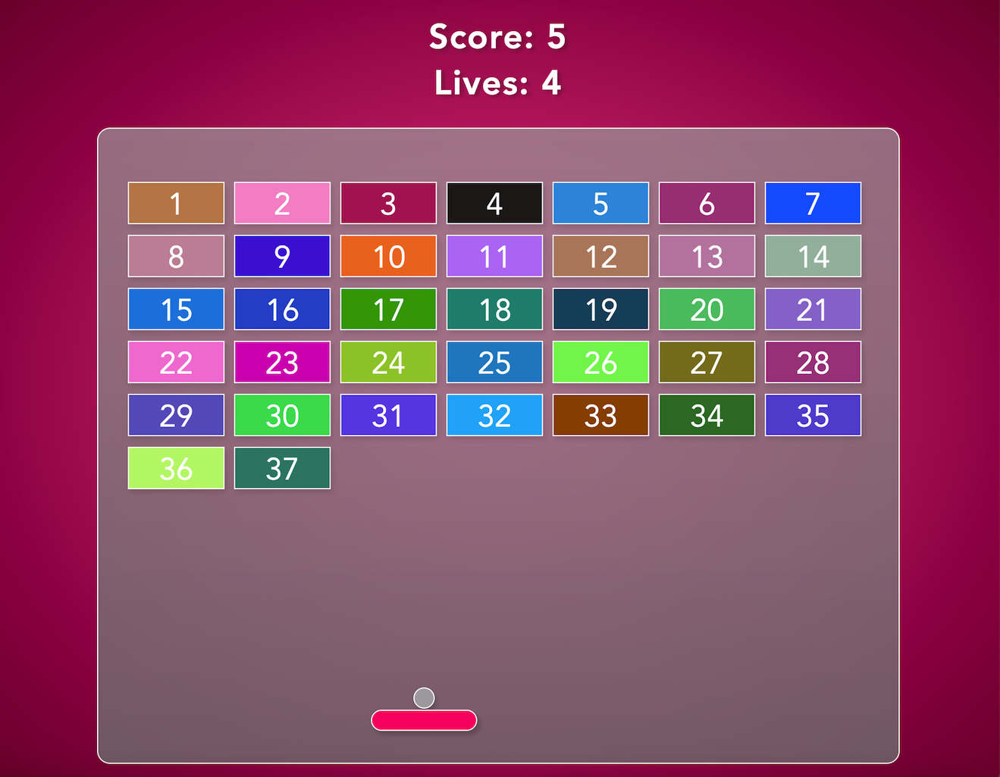

# Breakout Game
The popular Breakout Game written in Vanilla JavaScript. The idea is to create a cool version of the game by using JavaScript and keeping HTML and CSS simple and short. After all it's fun to see what you can create with just a few lines of code! Procedural programming is used here, which means that we are creating functions and objects line by line.


## Installation

1. Clone the repository:
   ```bash
   git clone https://github.com/tpreisig/breakout-game.git
   ```
2. Navigate to the project directory:
   ```bash
   cd breakout-game
   ```
3. Start the game
   ```bash
   open ./index.html
   ````
## License

This project is licensed under the MIT License - see the [LICENSE](LICENSE) file for details.


## Screenshots




## Contact

Maintained by tpreisig - feel free to reach out!
